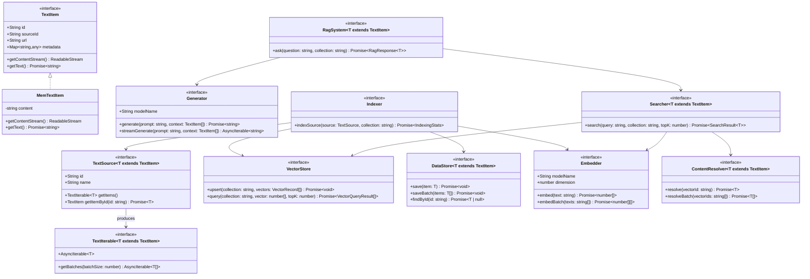

# Ragtime: search, RAG and chat

Ragtime is the generic retrieval framework under `src/ragtime/`; `src/biblioteca-rag/` is Biblioteca built on it.

## Design

The contracts, as first designed. The core grew beyond this (rerankers, query expansion, keyword retrieval, chat) - see the implementation below and `src/ragtime/core/model.ts`.

## Implementation

The design above is implemented in three layers:

- **`src/ragtime/core/`** - the reusable framework. `model.ts` holds every
  contract: `TextItem`/`TextSource`/`TextIterable`, `TextSplitter`,
  `VectorStore` and `VectorCollectionManager` (with a store-neutral
  `CollectionSpec`), `DataStore`, `Embedder` (query/passage purposes,
  `maxBatchSize`), `ChatModel` + `PromptBuilder` (together a `Generator`),
  `ContentResolver`, `Reranker`, `ContextExpander`, `Retriever`,
  `QueryExpander`, `KeywordIndex`, `Indexer`, `Searcher`,
  `RagSystem` (`ask`, `streamAsk`), `QueryRewriter`, `ConversationStore`,
  `Chatbot`. The generic implementations: `GenericIndexer` (dedup, language
  filter, truncation, vector reuse by id with payload repointing, sub-batching,
  hooks), `GenericSearcher` (score threshold read by score kind, `accept`,
  reranking), `HybridSearcher` (question and expansions, vector and keyword
  retrievers, pooled round-robin, reranked), `VectorRetriever`,
  `MemoryKeywordIndex` (BM25), `HypotheticalAnswerExpander` (HyDE),
  `LlmReranker`, `PromptedGenerator`/`DefaultPromptBuilder`, `RagtimeSystem`,
  `RagChatbot` with `LlmQueryRewriter`, `MemoryConversationStore`,
  `ParagraphSplitter`, `MemoryVectorStore`, `DataStoreContentResolver`, and
  test doubles. The core imports only itself and `node:` built-ins
  (`extractable.spec.ts` enforces it), so it can be lifted into a package
  as it is.
- **`src/ragtime/adapters/`** - `QdrantVectorStore` (REST; deterministic UUID
  point ids, the item id in the payload, rescoring on quantized collections),
  `OllamaEmbedder`, `OllamaChatModel` (editii-translator's generation
  options) with `OllamaGenerativeModelFinder` (lazily, on first use: the
  generating model already loaded on the shared GPU, else qwen3.5:9b),
  `CassandraDataStore`, `WebsiteTextSource`.
- **`src/biblioteca-rag/`** - Biblioteca on ragtime: `BibliotecaDivSource`
  (a work's paragraphs, id = sha256), the `{sha256, url, opus_path}` payload
  and point ids biblioteca-server's own vector search shares,
  `BibliotecaContentResolver` (hits back to paragraph text through their div,
  titled "Author, Work - Chapter"), `BibliotecaContextExpander` (each hit with
  its neighbouring paragraphs), `BibliotecaKeywordRetriever` (BM25 over the
  works of a small scope, read once and cached), scopes (`opusPaths`: a book,
  a collection, or the whole library) and `RagService` behind `/api/rag/*`.

Why questions search harder than `/api/rag/search`: measured on "A Christmas
Carol" (743 paragraphs), the paragraph answering a plot question ranks far
down by the question's vector alone - "whose Christmas ball...?" ~320th,
"what does Scrooge send...?" ~280th. Ask and chat therefore search with the
question and a drafted answer (HyDE), by vectors and, within a scope, by
keywords, then let the chat model rerank the pooled 60 candidates.
`novel-chat.integration.spec.ts` chats with the book (who/what questions,
follow-ups) against the live models, with tolerant assertions. A turn takes
~5-30 s on the shared GPU (rewrite, draft, rerank, answer).

Known limits:

- Conversations live in memory (`MemoryConversationStore`): lost on restart,
  per instance. A persistent `ConversationStore` is the next step for a real
  chat UI.
- User collections are per user on biblioteca-server; the caller (reader or
  server) turns a collection into its `opusPaths`.
- `/api/rag/*` costs GPU time on the shared Ollama (one request at a time)
  and has no authentication or rate limit of its own: it stays internal.
  biblioteca-reader's chat gate admits only signed-in users, one message at a
  time, 60 an hour and 400 a day (`chatLimit.ts` there), and every chat is
  recorded on `biblioteca_events` with its user.
- Resolving a hit reads its div's paragraphs (cached); a server endpoint
  returning paragraphs by URL (following relocations) would be cheaper.
  `GET /api/divs?path=` cannot do it: for a paragraph path it answers 500
  (it merges an unpersisted paragraph inside a read-only transaction).
- Answer quality is the generating model's: retrieval finds the right
  passages, qwen3.5:9b still slips on facts. A reranker and evaluation
  questions per work are the next levers.
